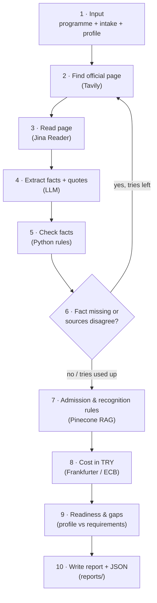

# Unioptt Programme Research Agent

> Project 3 · Ironhack AI Consulting Bootcamp (Berlin) · Approved by instructor
>
> Status: 🚧 Day 2 of 5 · tools, RAG knowledge base and LangGraph skeleton working

An autonomous research agent that checks the facts about one university programme and writes a **Programme Due Diligence Report** for a Turkish student and their family. Every key fact carries a **value, a verification status and a source link**, and anything the agent cannot confirm is marked as such instead of guessed.

---

## 1. The problem

In Türkiye, university entry depends on one central exam (YKS). Good public universities need very high scores, and good private universities are too expensive for most families. That is why many students look abroad.

Abroad, they meet a second problem: many consultancies and agencies are paid commission by foreign institutions. They steer students toward the institutions that pay them, so students and families rarely get an objective selection process.

**Unioptt** ([unioptt.netlify.app](https://unioptt.netlify.app)) is my answer to that: a matching platform that ranks programmes by how well they fit the student (interests, academic profile, budget, lifestyle), not by who pays a commission.

**The gap this project closes:** a matching engine is only as trustworthy as its programme data. Today Unioptt's 94 programmes are hand-entered in one static file with no provenance: no source URL, no verification date, no record of who entered a value. Tuition, deadlines and language requirements change every year, and nobody can say where a number came from or whether it is still true.

## 2. What this agent does

- **Input:** one programme (university + programme name), a target intake, and a synthetic student profile.
- **What happens:** the agent finds the official programme page, reads it, and extracts the key facts together with the exact sentence each fact came from. Python code (not the LLM) then checks every fact against the source. If a fact is missing or two sources disagree, the agent searches again (a limited number of times) before marking it Unknown or Needs Review. It adds country-level admission and recognition rules from a small curated knowledge base (RAG), converts costs from EUR to TRY, and compares the requirements with the student profile.
- **Output:** a one-page Programme Due Diligence Report (Markdown) **and** a machine-readable JSON record in the same format as Unioptt's backend schema (`ProgramRequirements` + `VerificationRecord`).
- **Boundary:** the agent does **not** rank programmes or judge fit. That is the job of Unioptt's deterministic matching engine. The agent may quote the engine's result, but it never recalculates it.

## 3. Who the report is for, and what "useful" means

**Primary user:** a Turkish student and their family deciding **whether to apply to one specific programme**. Secondary users are teachers and school counsellors who advise them.

**"Useful" means:**
- every key fact (tuition, application deadline, language requirement, academic requirements, scholarships, total yearly cost in TRY) has a **source link** and a **status**;
- facts that could not be confirmed are **named clearly**, never guessed;
- the report ends with the student's concrete **gaps** (e.g. language level, budget) and **next steps**.

**Sample programmes** (both taken from Unioptt's own catalogue):

| Programme | Country | Teaching language | Why it was chosen |
|---|---|---|---|
| University of Groningen, BSc Artificial Intelligence | Netherlands | English | Tests the Dutch non-EEA tuition fee that Turkish citizens pay, and an English-language requirement |
| Technical University of Munich (TUM), BSc Informatics | Germany | German | Tests a German-language requirement, Turkish diploma recognition, and whether "German universities are free" is still true for non-EU students |

The same synthetic student profile is used for both, so the reports show how one student's readiness differs between two programmes.

## 4. How this serves Unioptt

This project is the first building block of Unioptt's **data verification layer**. The agent connects to the product in two places:

```
(A) DATA SUPPLY      official pages → agent checks facts → JSON record → catalogue (with sources)
                                                                              │
                     student profile ────────────────────────────→ matching engine (unchanged)
                                                                              │
(B) DUE DILIGENCE    student picks a programme from the shortlist → agent → report
```

- **(A) Before matching:** the agent fills Unioptt's empty `ProgramRequirements` records, so the Prepare page can show real, sourced requirements instead of country defaults.
- **(B) After matching:** the student picks a programme, and the agent produces the due diligence report. This is the Project 3 MVP.

Because the agent's output uses the backend's own Pydantic schema, it can later move into the Unioptt FastAPI backend with few changes.

## 5. Stack decision (short version)

**Primary: LangGraph (Python). Helper: n8n (thin wrapper only).**

Researching a programme is not a straight line. After finding and reading the official page, the agent must decide what to do when a fact is missing or two sources disagree: search again, or mark the fact Unknown or Needs Review. LangGraph models these decisions as explicit nodes and conditional edges, so every branch is visible and testable, and its shared state lets each fact carry its value, status and source through the whole run. Unioptt's backend is already Python, so the agent can later become a module there.

n8n would be faster for the trigger and delivery, but loops with per-fact state and verification rules are hard to read and test on a visual canvas. So n8n only wraps the agent: form trigger → call the agent's API → Telegram delivery and Airtable run log. No research logic lives in n8n.

Full reasoning: [stack_decision.md](stack_decision.md) 

## 6. Architecture (happy path)



## 7. Verification rules

The agent uses Unioptt's existing four-state vocabulary. **Python code decides the status, not the LLM.**

| Status | When the agent uses it |
|---|---|
| **Verified** | All four checks pass: (1) the source is the university's own website or an official application portal; (2) the quoted sentence appears word for word in the downloaded page; (3) the value appears in that sentence; (4) the page refers to the target intake (or is not clearly outdated). |
| **Needs Review** | Found on an official page, but a check fails, or two official pages disagree (both links are kept). |
| **Inferred** | From an unofficial source, calculated (e.g. cost in TRY), or a general country rule from the knowledge base applied to this programme. |
| **Unknown** | Not found after the allowed number of searches. Never guessed. |

## 8. Tools

| Role | Tool | Notes |
|---|---|---|
| Web search | Tavily | Finds the official programme pages |
| Page → clean text | Jina Reader | Separate provider from search |
| Exchange rates | Frankfurter (ECB data) | Free, no key; EUR → TRY |
| Knowledge base (RAG) | Pinecone | Curated public documents on DE/NL admission, scholarships and Turkish diploma recognition |
| LLM | OpenAI `gpt-4o-mini` | Fact extraction and report writing; `text-embedding-3-small` for embeddings |
| Wrapper | n8n | Form trigger, Telegram delivery, Airtable run log (Day 4) |

## 9. Report structure

| # | Section | Contents |
|---|---|---|
| 0 | Header | Programme, university, target intake, run date, Unioptt match result (quoted, if given) |
| 1 | Programme snapshot | City, degree, teaching language, duration, mandatory placement, thesis requirement |
| 2 | Key requirements | Language, academic, application platform, deadlines, documents |
| 3 | Total yearly cost | Tuition + living costs in EUR and TRY |
| 4 | Recognition | How a Turkish high-school diploma is treated (YKS, Studienkolleg, YÖK rules) |
| 5 | Scholarships | Which exist; automatic vs apply-required |
| 6 | Readiness & gaps | Profile vs requirements: language, GPA, budget |
| 7 | What's missing & next steps | Unknown / Needs Review facts + 3 concrete actions |
| 8 | Sources & verification log | Every fact: value, status, source link, quote |

Target length: sections 0–7 on about one page; section 8 has no length limit.

## 10. Repository structure

```
├── README.md
├── stack_decision.md         
├── gtm_future_sprints.md     (Day 4)
├── requirements.txt
├── .env.example              (keys needed, empty values)
├── run.py                    (CLI entry point)
├── src/                      (tools, RAG, LangGraph graph, report writer, API)
├── corpus/                   (public reference documents for RAG)
├── data/sample_profile.json  (synthetic student profile)
├── reports/                  (generated sample reports)
└── n8n/                      (exported n8n workflow)
```

## 11. Setup & how to run

_Coming Day 5._

## 12. Sample reports

_Coming Days 3–4._

## 13. Scope & limitations

- **Data:** the student profile is synthetic. No real personal data, no assessment data, no database.
- **Sources:** only public programme pages and public reference documents; robots.txt and site terms are respected.
- **Not legal advice:** information on diploma recognition (YÖK denklik) and visas is reported with its source, not as a legal opinion.
- **Facts, not judgements:** the agent never creates scores, ranks programmes or interprets psychometric data.
- **Agent-verified vs human-verified:** "Verified" here means the agent's automatic checks passed. In Unioptt's backend, `last_verified` currently means a human confirmed the data; a `verified_by` field will be needed when the agent is integrated. A sample of Verified facts is checked by hand for each report.
- **MVP scope:** Germany and the Netherlands only; English-language reports; runs locally; no user accounts or production deployment.

## 14. Next: go-to-market sprints

See [gtm_future_sprints.md](gtm_future_sprints.md) *(coming Day 4)*.
